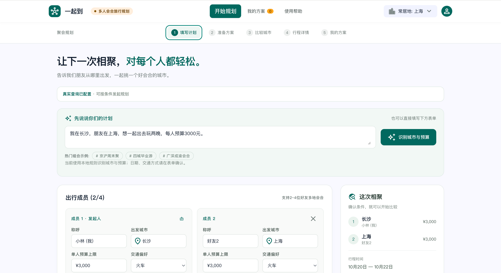
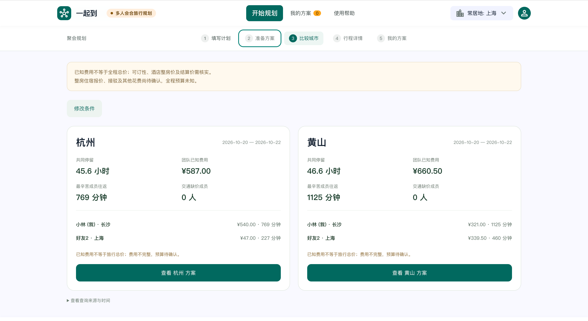
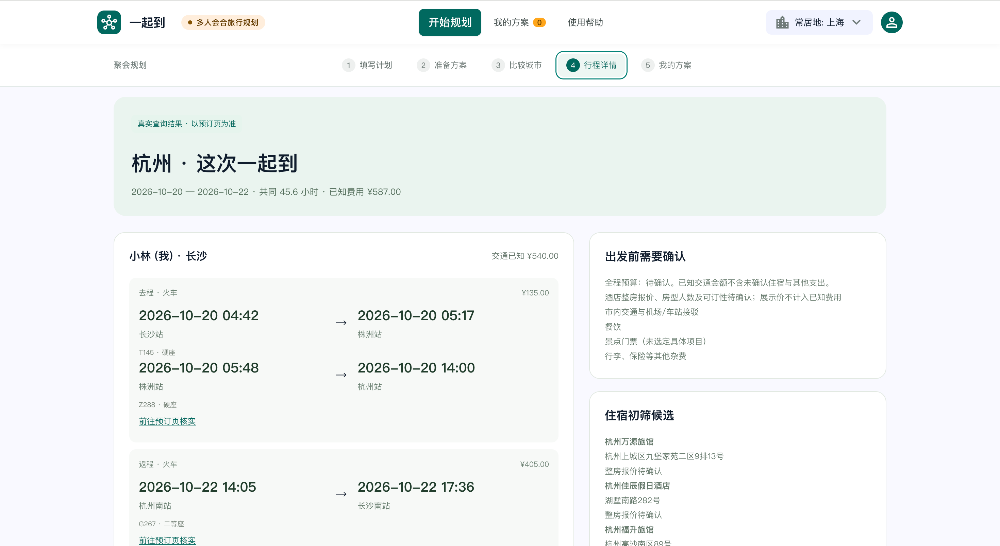
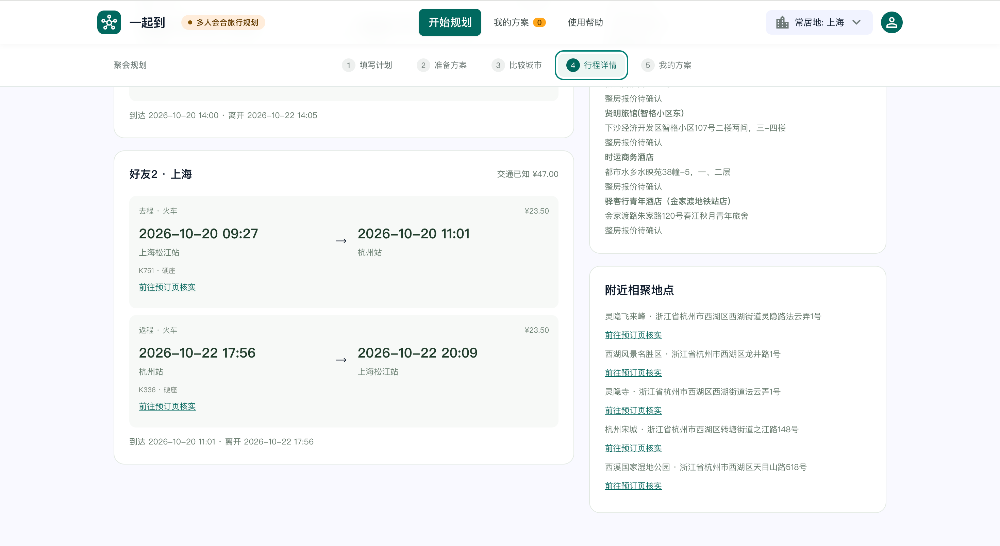
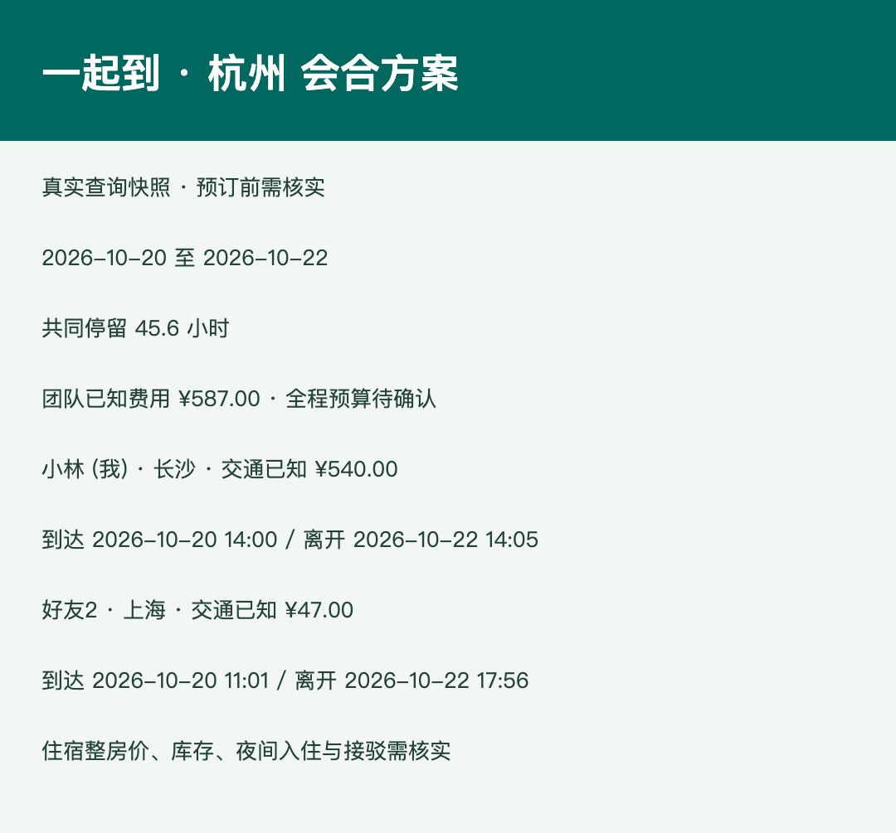

<!-- 提交前：确认团队与唯一主要提交人；补 GitHub 仓库链接；上传图片替换相对路径；视频可稍后补。 -->
<!-- Issue 标题：【2026飞猪AI旅行创新大赛】一起到——多人异地会合旅行助手 -->

## 参赛项目名称

一起到——多人异地会合旅行助手

## 团队 / 作者与奖品领取人

- 团队名称：落梦飞花
- 主要提交人 GitHub ID（仅 1 位，必填）：hope0719
- 其他成员（可选，仅用于署名）：暂无登记

## 旅行场景与目标用户

朋友分散在不同城市，约一次旅行时，往往先定目的地，再各自查车票和酒店。有的人路上要花十几个小时，有的人一个多小时就到；价格便宜也不代表大家能多待一会儿。

一起到面向 2–4 位异地朋友、同学和小团体。大家填写出发城市、日期、预算和交通偏好，再比较几个会合城市，看看去哪儿能兼顾交通负担、已知费用和共同停留时间。

## 我做了什么

做了一个可公开体验的网页，覆盖填写条件、真实查询进度、城市比较、逐人交通详情、方案保存、匿名分享和 PNG 导出。

城市比较同时展示共同停留、团队已知费用、最辛苦成员的往返时长和交通缺价人数。价格与时间由程序根据接口返回结果计算，模型负责调用工具，不自行编造车次、价格或计算结果。

截图中的例子是长沙和上海两位朋友会合。杭州的共同停留为 45.6 小时、已知交通费用 587 元；黄山为 46.6 小时、660.50 元。用户可以结合路上负担做选择。住宿整房报价和其他费用未确认，因此页面明确写“全程预算待确认”，不会把交通小计当旅行总价。

## 百炼使用说明（必填）

- 百炼能力 / 模型：运行时使用阿里云百炼 Managed Agent，已验收智能体 v4，模型 Qwen3.8-Flash。
- 调用方式：网站服务端通过百炼 Managed Agent HTTP API 创建会话、提交已确认的结构化请求，读取进度事件与结果文件。
- 使用环节与输入输出：输入是成员出发城市、日期、预算上限、交通方式、共同停留要求及候选城市；智能体调用已挂载 Skill 中的 Python 程序，并通过 FlyAI 官方 CLI 查询交通、候选酒店及景点。输出引擎原生 JSON，网站校验查询来源后展示比较与行程。
- Skill 名称（如有）：yiqidao，已验收云端版本 1.3。
- 其他工具 / 技术栈：FlyAI 官方 CLI、Python 规划引擎、Vinext / React、Cloudflare Workers、D1、浏览器 PNG 导出。

输入页自然语言框目前使用本地规则识别城市和预算，日期与其他条件由用户确认，未把它描述成模型语义解析。

## 效果展示

以下为实际运行截图。已知金额不包含未确认的整房住宿、餐饮、门票和接驳等支出。

查询进度辅助图：`截图/01-查询进度.png`。

演示视频：https://github.com/hope0719/yiqidao/releases/tag/demo-v1

## 项目链接与复现方式

- 在线 Demo：https://yiqidao-meet-travel.mingtian008.chatgpt.site/
- GitHub 源码仓库：https://github.com/hope0719/yiqidao

体验步骤：

1. 打开网站，填写 2–4 位成员的出发城市、日期、预算与交通偏好。
2. 选择候选会合城市，确认条件并发起规划。真实查询受体验额度和上游服务状态限制。
3. 查看查询进度；已有任务可刷新恢复，避免重复提交。
4. 比较城市的共同停留、交通费用和往返负担，进入详情查看逐人去返程、住宿候选及景点。
5. 展开查询来源与时间，按预订页核实班次、库存和最终结算价；可保存、匿名分享或导出 PNG。

数据随日期、查询时间与上游返回结果变化，不保证再次查询得到截图中的同一组车次或金额。演示模式使用虚构数据，单独标明，不消耗旅行接口或模型调用。

## 踩坑记录（可选）

最容易误导用户的是把酒店展示价当整房报价、把交通小计当全程预算。我保留缺价和待确认状态，让用户知道哪些费用还没算完整。

接真实链路时遇到过 FlyAI 429。失败会显示失败或暂停，不用演示数据替代真实结果；后续经授权配置正式凭证完成网页闭环验收。

为控制体验成本，网站限制真实任务数和并发、每次任务的旅行查询规模。普通页面访问和已有方案查看不会发起模型规划；重新发起真实任务会消耗调用额度。密钥保存在服务端秘密配置中，不进入公开代码或截图。
